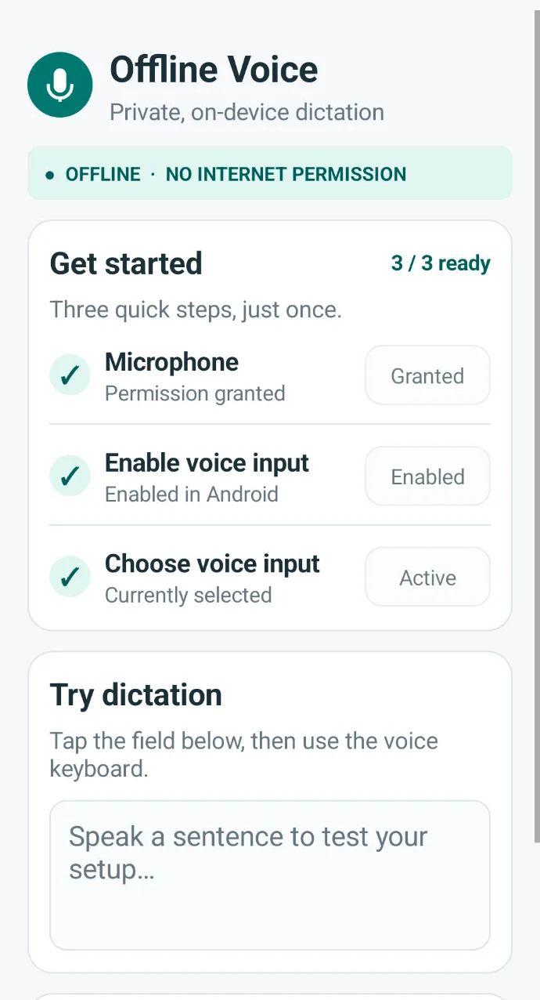
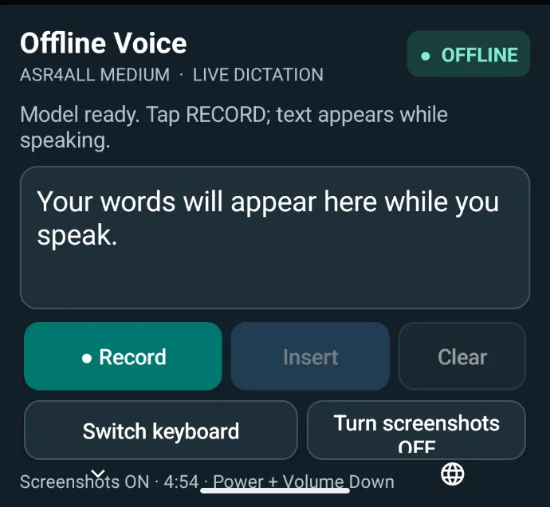

[README.md](https://github.com/user-attachments/files/35442458/README.md)
# Offline Voice Input

**Private, on-device speech-to-text for Android.**  
A voice-only keyboard that transcribes your speech locally and inserts the result into the text field you choose.

> **Experimental beta — Alpha 3 R9** · English dictation · Android 10+ (ARM64)  
> Developed independently; not an official FUTO product.

Offline Voice uses **FUTO asr4all Medium** with **ExecuTorch XNNPACK INT8** for incremental, on-device speech recognition. It does **not** request Android's `INTERNET` permission. The recognition model is included in the APK rather than downloaded by the phone.

## What it does

- **Live transcription:** See recognized words appear in the voice-input panel while speaking.
- **You control insertion:** Review the result, then tap **Insert**. The app does not automatically send messages.
- **Voice-only input:** Works as an Android input method; switch back to your usual keyboard when needed.
- **Offline by design:** Microphone audio is processed on the device, without uploading recordings for transcription.
- **Privacy safeguards:** No dictation history or saved audio recordings; recording is disabled for password fields.
- **Optional UI screenshots:** Normal Android screenshots can be temporarily enabled for five minutes, then automatically disabled again.

## First-time setup

Open **Offline Voice** on your Android phone and complete the three setup steps:

1. **Microphone:** Tap **Allow** and grant microphone permission.
2. **Enable voice input:** Tap **Enable**, then enable Offline Voice in Android's keyboard settings.
3. **Choose voice input:** Tap **Choose** and select Offline Voice as your active input method.

When all three are complete, the setup screen shows **3 / 3 ready**. Use the **Try dictation** field to confirm it is working.

*Actual Pixel setup screen — Alpha 3 R9. The setup steps are complete.*

> **Android keyboard warning:** Android may display a warning when you enable a third-party input method. It is a system warning, not a request for internet access. Review the permissions and install only builds you trust.

## Dictating in another application

1. Open a regular text field in an app such as Notes, a messenger, or a browser.
2. Select **Offline Voice** as the keyboard if it is not already selected.
3. Tap **Record** and speak normally. Words should begin appearing in the transcription panel while you are talking.
4. Tap **Stop** to finalize recognition and allow the model's punctuation/capitalization pass to complete.
5. Review the transcript, then tap **Insert** to place it in the active text field.

**Clear** discards the current draft; **Switch keyboard** returns to a different installed keyboard. For privacy, do not assume the receiving app is offline merely because Offline Voice is.

*Actual Pixel voice keyboard. The unrelated host app is cropped out of this screenshot.*

## Temporary normal screenshots (UI feedback)

To capture the app interface for layout feedback:

1. Open the **Android screenshots** section of Offline Voice, or use the screenshot control in its voice keyboard.
2. Choose **Enable for 5 min**. The display shows **ON** and the remaining time.
3. Press **Power + Volume Down** on your Pixel to take a normal Android screenshot.
4. The screenshot allowance **expires automatically after five minutes**. You can also switch it off early.

Screenshot mode starts **OFF**. Outside the temporary window, Offline Voice restores its `FLAG_SECURE` protection. Screenshots taken during the window may contain the contents of the *other* app on screen, as well as your dictated text. **Review and redact screenshots before sharing**; turning the mode off does not delete screenshots already saved by Android. Other apps' screenshot protections are not bypassed.

## Build from source (Android Studio)

The project targets Android API 37 and currently builds for **ARM64** (`arm64-v8a`). The Alpha 3 R9 project uses **Gradle 9.4.1**, **Android Gradle Plugin 9.2.0**, and Java 17.

1. Extract the Android Studio source project into a fresh folder.
2. Open that folder in Android Studio with the Android SDK/NDK configured.
3. Connect your build computer to the internet for the **first build**. Its setup task downloads the pinned FUTO asr4all Medium model (~60 MB), verifies its SHA-256 checksum, and packages it with the app.
4. Select **Build → Build APK(s)**, then install the resulting APK on a compatible Android device.
5. After installing, voice recognition runs locally; the phone does not need internet access to dictate.

The model is not stored in this README package. The required model, metadata, and license are prepared by the **Android Studio source project's** verified build process.

### If something does not work

| Issue | Check |
| --- | --- |
| No voice keyboard appears | Enable Offline Voice in Android keyboard settings, then choose it as the active input method. |
| Microphone does not start | Confirm the microphone permission and that another app is not exclusively using it. |
| No words appear | Check that the model reports **ready**; then try a short sentence in a quiet environment. |
| **Insert** is unavailable | Make sure the transcript is nonempty and a permitted text field is active; password fields are intentionally restricted. |
| Model setup fails during the first build | Check `app/build/asr4all/model-setup.log`. Do **not** disable SHA-256 or TLS verification. |
| Can't take a screenshot | Enable the temporary five-minute mode. A host app may have its own screenshot restrictions. |

## Privacy and limitations

- The APK requests microphone access but **no Android internet permission**.
- Audio is processed in memory, rather than saved as a recording; no dictation-history feature is provided.
- Dictated text is transferred to the *receiving app* when you press **Insert**. That app controls what it does with the text afterward.
- The temporary Android screenshot feature can capture private on-screen content. Use it only when needed.
- This is an **experimental beta**, not a security-audited release. Recognition quality and latency will vary with device performance, speech, and noise.

## Model attribution and licensing

The recognition model is **[FUTO asr4all Medium](https://huggingface.co/futo-org/asr4all-m)**, run using [ExecuTorch](https://github.com/pytorch/executorch). The FUTO model weights are distributed under the **FUTO Model Weights License (Restricted Use) 1.0**, **not** a conventional unrestricted open-source license. Consult the upstream license before redistributing the weights or an APK containing them. This project is not affiliated with or endorsed by FUTO.

---

**Status:** Alpha 3 R9 · Interface demonstrated on a Pixel 9 Pro XL · Feedback and testing welcome.  
**Screenshots:** Real user-provided screenshots. No simulated or AI-generated interfaces.
